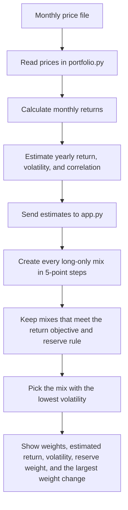

# Lab 15: Portfolio Stability

## Question

Which mix carries the least risk while meeting the mandate, and does the answer survive a one-point change in one estimate?

## How the app works

The return, volatility, and correlation figures are estimates from past prices. They are not forecasts.

## Meridian known answers

All three known answers match.

| Change tested | Mix: bills / 10-year note / investment-grade bonds / global equity | Return | Volatility | Reserve weight | Largest weight change |
|---|---:|---:|---:|---:|---:|
| As loaded | 0 / 20 / 25 / 55 | 6.51% | 9.44% | 20% | — |
| Global equity return: 8% to 7% | 0 / 10 / 10 / 80 | 6.53% | 12.94% | — | 25 points |
| Investment-grade bond and global equity correlation: 0.25 to 0.50 | 0 / 40 / 0 / 60 | 6.52% | 9.73% | — | — |

## My universe

| Ticker | Fund | Role in this exercise |
|---|---|---|
| SGOV | iShares 0-3 Month Treasury Bond ETF | Cash reserve |
| IEF | iShares 7-10 Year Treasury Bond ETF | Government bonds |
| USIG | iShares Broad USD Investment Grade Corporate Bond ETF | Corporate bonds |
| VT | Vanguard Total World Stock ETF | Global stocks |

The source is Yahoo Finance monthly adjusted-close prices. The price file was downloaded on 2026-10-22 with `get_prices.py` and covers October 2021 through September 2026.

The return objective is 6.5%. It is an estimate: 2.5% inflation plus 4%. The reserve rule is at least 3% in SGOV plus IEF. All returns below are estimates from history, not forecasts.

## My results

| Price period | Estimated yearly returns: SGOV / IEF / USIG / VT | Lowest-risk mix: SGOV / IEF / USIG / VT | Estimated return | Volatility | Reserve weight |
|---|---:|---:|---:|---:|---:|
| All 59 monthly returns | 3.78% / -1.73% / 0.04% / 11.05% | 60 / 0 / 0 / 40 | 6.69% | 6.04% | 60% |
| Last 36 monthly returns | 4.44% / 3.07% / 5.21% / 20.25% | 85 / 0 / 0 / 15 | 6.81% | 1.79% | 85% |

The largest weight change is 25 points: SGOV increases by 25 points and VT falls by 25 points.

## Two app bugs found and fixed with Codex

1. The expected-return boxes did not allow negative numbers. IEF had a negative estimated return, so the app could not show that result. The boxes now allow negative 100% through positive 100%.
2. The expected-return boxes kept the old all-month numbers when the user switched to the last 36 months. The boxes now have separate saved values for each price period.

## Partner attack and my answer

Attack: "Your answer just follows the past. The last 36 months had stocks up about 20% a year, which won't last, so 85% cash will miss the 6.5% goal."

My answer: My partner is right that the returns come from history, not forecasts, and the mix changed by 25 points just from using fewer months. That's why I treat the answer as a range, between 60/40 and 85/15 cash to stocks, instead of one exact mix.

## My call

Pilot, not adopt. I'd start with the all-months mix (60% SGOV, 40% VT) because it uses more history, including the bad 2022 year. I'd only fully adopt it if the mix stays within about 10 points when I test other time periods or forward-looking return estimates.

## What I learned

The search always finds an answer, but the answer depends on the estimates. Changing only which months I used, with the same funds and the same rules, moved a quarter of the portfolio. Small changes in estimated returns cause big changes in the "best" mix.

## Reflect

Why did the mix move? In the last 36 months stocks returned about 20% a year and bonds were positive again, so it takes much less stock to reach 6.5%. The search picks the lowest risk, so it fills the rest with cash. Over all 59 months, 2022 pulled bond returns negative and stock returns lower, so it needed 40% stocks.

What would I need before adopting it? Forward-looking return estimates instead of just past returns, a longer price history, and a check that the mix doesn't swing much when one estimate moves by a point. I'd also need to remember that SGOV's 4% return only lasts while interest rates stay high.
